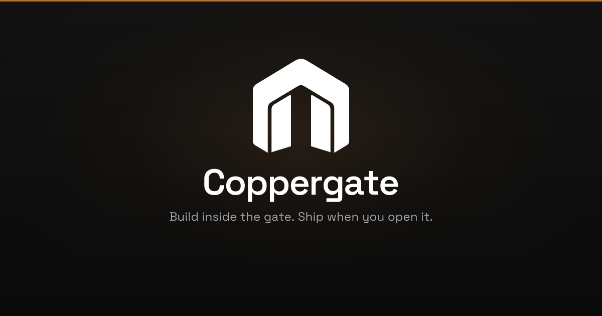

  
    

  **Autonomous multi-agent Survivor arena**

  Contenders compete. Fitness decides. Losers lose budget. 
  You set the goal, the policy, and the kill-switch.

   

  [coppergate.ai](https://coppergate.ai) · [hello@coppergate.ai](mailto:hello@coppergate.ai)

---

### The idea

Builders stitch chat assistants, coding agents, and dashboards — then become the bottleneck. Coppergate flips that: agents race inside the arena; the **gate is fitness** (tests, CI, critic, policy, budget), not a human click on every task.

**Promise:** The most agentic system you can leave running — agents fight; survivors ship.

### How the arena works

1. **Configure** — goal, spend caps, policy, and a kill-switch
2. **Compete** — multiple contenders work the same outcome in parallel
3. **Select** — fitness evidence promotes winners; losers lose budget
4. **Ship** — survivors move forward; production stays policy-gated

Initial wedge: **GitHub-native fitness** — branches, PRs, and CI as the first arena surface.

### Repositories

| Repository | Role |
|---|---|
| [`coppergate`](https://github.com/coppergateai/coppergate) | Product monorepo — web, worker, packages |
| [`coppergate-architecture`](https://github.com/coppergateai/coppergate-architecture) | Spec, ADRs, backlog, brand |
| [`coppergate-examples`](https://github.com/coppergateai/coppergate-examples) | Fixture apps for agent / e2e runs |

### Status

Private while we ship the arena wedge. Early access and product updates live at [coppergate.ai](https://coppergate.ai).

**Build inside the gate. Survive to ship.**

